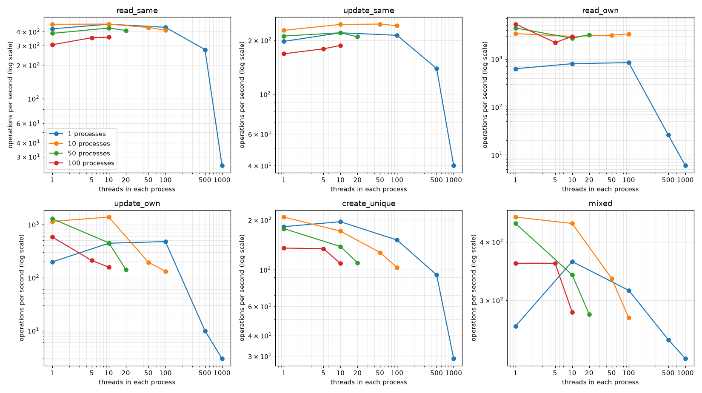
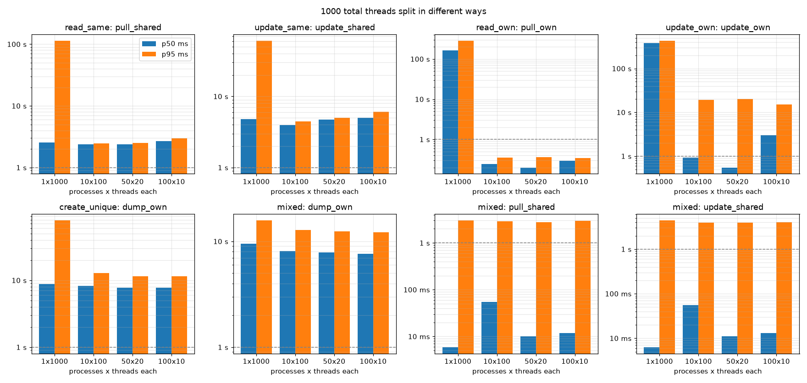
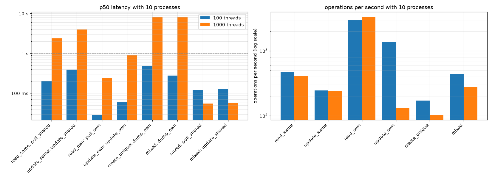
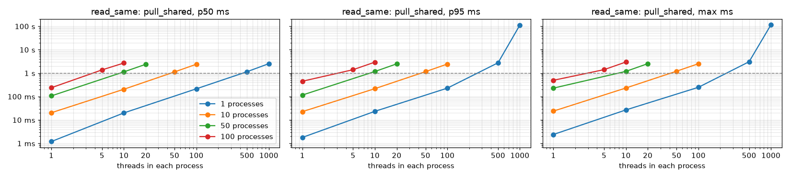
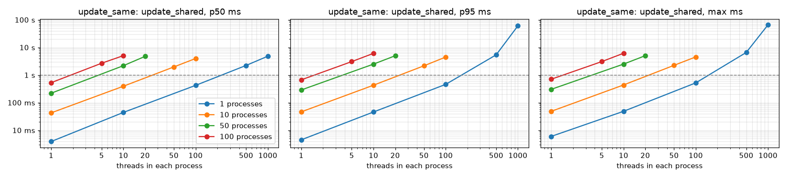
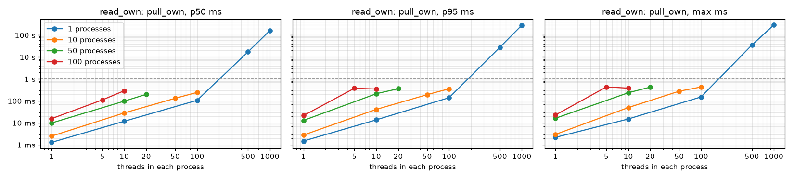
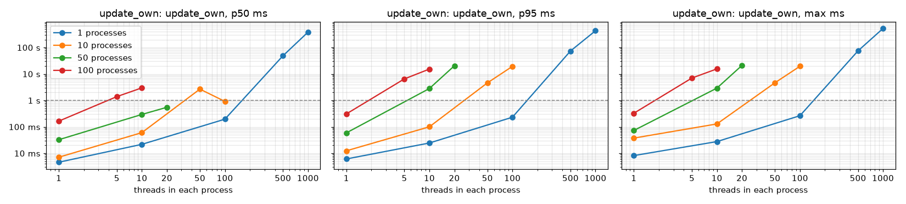
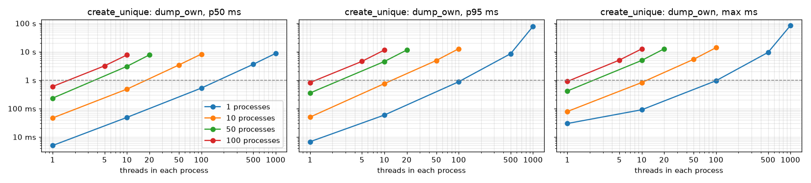
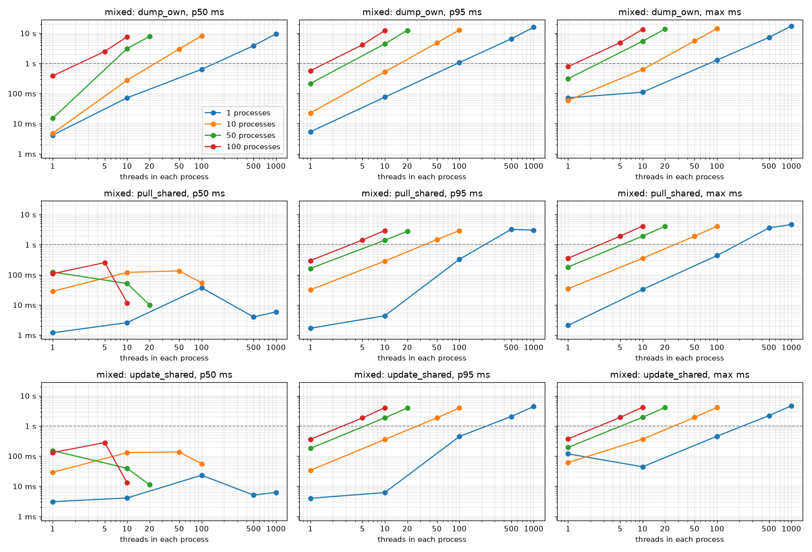

Contention benchmark
====================

The benchmark starts many processes, each running many threads, that all work on the same repository.
Every run checks the repository afterwards, and the integrity column reads OK when nothing was lost or corrupted.

- pyrep 4.0.0, python 3.12.10, Darwin 25.3.0 x86_64
- 16 logical processors, open file limit 12000
- One Repository instance per process; shared record of 2000 items
- Date: 2026-10-21
- ops/s counts every timed operation of the run. The latencies are per operation, in milliseconds.
- The scenario graphs show p50, p95 and max latency, one line for each number of processes, on logarithmic axes. The dashed line marks one second. The tables also give p99.

.. code-block:: bash

    python3 benchmark/bench_ladder.py --markdown results.md

Scenarios
---------

In every scenario, each thread repeats its step many times. All threads of all processes start together.
*Shared* means every thread uses one file. *Own* means each thread has its own file.

.. csv-table::
    :header: "scenario", "what every thread does", "what it measures"
    :widths: 18, 47, 35

    read_same, "Reads the one shared file (``pull_file``).", "Many readers on one file."
    update_same, "Rewrites the one shared file (``update_file``).", "Many writers fighting for one file."
    read_own, "Reads its own file.", "Readers that never touch the same file."
    update_own, "Rewrites its own file.", "Writers that never touch the same file."
    create_unique, "Creates a new file of its own at every step (``dump_file``).", "Many writers adding files to the repository."
    mixed, "At every step reads the shared file, rewrites it, then creates a new file of its own.", "All three operations together."

Every read checks that the record is complete and not a mix of two writes. Every run ends with an audit of the files on disk.
The integrity column reads OK when all those checks passed.

Operation names in the tables: ``pull_shared`` reads the shared file, ``pull_own`` reads the thread's own file,
``update_shared`` and ``update_own`` rewrite them, and ``dump_own`` creates a new file.

Latency columns: ``p50`` is the typical time, half of the operations were faster. ``p95`` and ``p99`` are the times that
95 and 99 of every 100 operations stayed under, so they show the slow cases. ``max`` is the slowest single operation.

Comparisons
-----------

Operations per second against the number of threads in each process. A line that stays flat means more threads add no work done.

The same 1000 threads split in different ways. It shows whether processes or threads are the better way to add load.

All scenarios side by side at 100 and 1000 total threads, with 10 processes.

Runs record 300 to 3000 operations, as the operations column shows. The slowest operation of a bigger run is therefore not directly comparable with the slowest operation of a smaller run.

read_same
---------

.. csv-table::
    :header: "processes", "threads each", "total threads", "operation", "operations", "wall s", "ops/s", "p50 ms", "p95 ms", "p99 ms", "max ms", "integrity"

    1, 1, 1, pull_shared, 300, 0.7, 424, 1.2, 1.8, 2.1, 2.4, OK
    1, 10, 10, pull_shared, 300, 0.6, 467, 20.0, 23.4, 25.7, 26.9, OK
    1, 100, 100, pull_shared, 300, 0.7, 438, 214.3, 229.1, 246.1, 248.7, OK
    1, 500, 500, pull_shared, 1500, 5.4, 276, 1153.0, 2771.0, 2967.0, 3069.0, OK
    1, 1000, 1000, pull_shared, 3000, 120.4, 25, 2545.9, 113555.9, 114832.2, 115473.7, OK
    10, 1, 10, pull_shared, 300, 0.6, 466, 20.4, 22.7, 23.4, 23.9, OK
    10, 10, 100, pull_shared, 300, 0.6, 468, 204.8, 217.5, 227.6, 232.3, OK
    10, 50, 500, pull_shared, 1500, 3.4, 436, 1129.4, 1162.0, 1178.7, 1213.4, OK
    10, 100, 1000, pull_shared, 3000, 7.3, 413, 2397.2, 2450.5, 2459.0, 2527.2, OK
    50, 1, 50, pull_shared, 300, 0.8, 386, 106.8, 116.1, 221.0, 229.1, OK
    50, 10, 500, pull_shared, 1500, 3.5, 431, 1132.6, 1175.3, 1178.9, 1192.1, OK
    50, 20, 1000, pull_shared, 3000, 7.3, 410, 2382.9, 2492.7, 2496.6, 2538.4, OK
    100, 1, 100, pull_shared, 300, 1.0, 305, 238.2, 451.6, 488.7, 495.4, OK
    100, 5, 500, pull_shared, 1500, 4.2, 353, 1378.5, 1403.9, 1411.7, 1413.4, OK
    100, 10, 1000, pull_shared, 3000, 8.4, 357, 2703.2, 2950.8, 2957.1, 2985.2, OK

update_same
-----------

.. csv-table::
    :header: "processes", "threads each", "total threads", "operation", "operations", "wall s", "ops/s", "p50 ms", "p95 ms", "p99 ms", "max ms", "integrity"

    1, 1, 1, update_shared, 300, 1.5, 197, 3.9, 4.5, 5.0, 6.0, OK
    1, 10, 10, update_shared, 300, 1.4, 220, 44.2, 45.8, 46.6, 48.5, OK
    1, 100, 100, update_shared, 300, 1.4, 213, 421.9, 458.5, 488.4, 519.8, OK
    1, 500, 500, update_shared, 1500, 10.8, 139, 2223.2, 5392.2, 5976.6, 6572.2, OK
    1, 1000, 1000, update_shared, 3000, 74.4, 40, 4813.6, 60520.6, 63253.5, 65637.0, OK
    10, 1, 10, update_shared, 300, 1.3, 227, 42.6, 46.3, 47.8, 48.6, OK
    10, 10, 100, update_shared, 300, 1.2, 245, 392.7, 427.4, 430.6, 436.5, OK
    10, 50, 500, update_shared, 1500, 6.1, 246, 1965.0, 2157.6, 2167.1, 2244.0, OK
    10, 100, 1000, update_shared, 3000, 12.4, 241, 3963.1, 4477.8, 4493.2, 4529.6, OK
    50, 1, 50, update_shared, 300, 1.4, 211, 219.4, 287.7, 302.4, 303.9, OK
    50, 10, 500, update_shared, 1500, 6.8, 220, 2178.7, 2483.9, 2486.3, 2489.7, OK
    50, 20, 1000, update_shared, 3000, 14.3, 209, 4746.3, 4982.2, 4991.0, 5016.6, OK
    100, 1, 100, update_shared, 300, 1.8, 168, 528.6, 669.5, 699.9, 707.1, OK
    100, 5, 500, update_shared, 1500, 8.4, 179, 2676.6, 3061.0, 3064.2, 3066.3, OK
    100, 10, 1000, update_shared, 3000, 16.0, 187, 5038.1, 6094.2, 6135.0, 6146.7, OK

read_own
--------

.. csv-table::
    :header: "processes", "threads each", "total threads", "operation", "operations", "wall s", "ops/s", "p50 ms", "p95 ms", "p99 ms", "max ms", "integrity"

    1, 1, 1, pull_own, 300, 0.5, 628, 1.3, 1.5, 1.6, 2.2, OK
    1, 10, 10, pull_own, 300, 0.4, 799, 11.9, 13.8, 14.5, 15.1, OK
    1, 100, 100, pull_own, 300, 0.4, 840, 107.0, 140.8, 147.7, 152.6, OK
    1, 500, 500, pull_own, 1500, 56.8, 26, 17258.2, 28252.3, 32177.9, 35703.2, OK
    1, 1000, 1000, pull_own, 3000, 522.5, 6, 162009.6, 284220.1, 289661.5, 290294.5, OK
    10, 1, 10, pull_own, 300, 0.1, 3376, 2.5, 2.8, 2.9, 3.0, OK
    10, 10, 100, pull_own, 300, 0.1, 2966, 28.6, 41.3, 46.3, 50.0, OK
    10, 50, 500, pull_own, 1500, 0.5, 3149, 132.1, 193.7, 222.2, 277.7, OK
    10, 100, 1000, pull_own, 3000, 0.9, 3341, 244.8, 357.0, 399.6, 432.0, OK
    50, 1, 50, pull_own, 300, 0.1, 4440, 9.9, 13.0, 14.6, 16.3, OK
    50, 10, 500, pull_own, 1500, 0.6, 2715, 98.5, 213.3, 225.2, 235.6, OK
    50, 20, 1000, pull_own, 3000, 0.9, 3206, 200.0, 360.0, 382.1, 425.6, OK
    100, 1, 100, pull_own, 300, 0.1, 5353, 15.6, 21.6, 22.5, 23.0, OK
    100, 5, 500, pull_own, 1500, 0.7, 2208, 111.8, 377.6, 422.9, 433.2, OK
    100, 10, 1000, pull_own, 3000, 1.0, 2948, 291.6, 346.9, 356.2, 382.6, OK

update_own
----------

.. csv-table::
    :header: "processes", "threads each", "total threads", "operation", "operations", "wall s", "ops/s", "p50 ms", "p95 ms", "p99 ms", "max ms", "integrity"

    1, 1, 1, update_own, 300, 1.5, 197, 4.6, 6.1, 7.9, 8.2, OK
    1, 10, 10, update_own, 300, 0.7, 443, 21.8, 24.5, 26.5, 27.7, OK
    1, 100, 100, update_own, 300, 0.6, 476, 195.1, 231.3, 253.0, 264.1, OK
    1, 500, 500, update_own, 1500, 147.6, 10, 48594.3, 73865.8, 74456.1, 74708.6, OK
    1, 1000, 1000, update_own, 3000, 1125.0, 3, 379908.9, 430161.9, 471993.7, 524822.5, OK
    10, 1, 10, update_own, 300, 0.3, 1138, 7.1, 12.4, 36.9, 37.6, OK
    10, 10, 100, update_own, 300, 0.2, 1376, 60.4, 100.3, 116.8, 128.9, OK
    10, 50, 500, update_own, 1500, 7.7, 194, 2672.7, 4605.3, 4626.8, 4650.5, OK
    10, 100, 1000, update_own, 3000, 22.8, 132, 916.7, 19388.1, 19514.3, 19569.3, OK
    50, 1, 50, update_own, 300, 0.2, 1284, 32.6, 59.1, 68.6, 73.0, OK
    50, 10, 500, update_own, 1500, 3.3, 450, 294.2, 2810.8, 2872.4, 2915.4, OK
    50, 20, 1000, update_own, 3000, 21.2, 142, 549.3, 20372.4, 20858.3, 20958.5, OK
    100, 1, 100, update_own, 300, 0.5, 581, 164.7, 307.7, 322.0, 327.2, OK
    100, 5, 500, update_own, 1500, 7.1, 210, 1392.2, 6512.2, 6586.7, 7019.4, OK
    100, 10, 1000, update_own, 3000, 19.1, 157, 2979.6, 15300.3, 15456.6, 15554.8, OK

create_unique
-------------

.. csv-table::
    :header: "processes", "threads each", "total threads", "operation", "operations", "wall s", "ops/s", "p50 ms", "p95 ms", "p99 ms", "max ms", "integrity"

    1, 1, 1, dump_own, 300, 1.6, 182, 5.0, 6.8, 7.9, 29.8, OK
    1, 10, 10, dump_own, 300, 1.5, 195, 48.9, 59.1, 81.1, 90.7, OK
    1, 100, 100, dump_own, 300, 2.0, 151, 525.3, 879.5, 936.2, 957.2, OK
    1, 500, 500, dump_own, 1500, 16.2, 93, 3625.4, 8558.7, 9074.3, 9487.4, OK
    1, 1000, 1000, dump_own, 3000, 101.9, 29, 8768.1, 78490.8, 81682.4, 83639.9, OK
    10, 1, 10, dump_own, 300, 1.4, 208, 46.7, 50.1, 69.2, 78.9, OK
    10, 10, 100, dump_own, 300, 1.8, 171, 483.7, 755.9, 816.2, 827.0, OK
    10, 50, 500, dump_own, 1500, 11.8, 127, 3428.8, 4934.7, 5344.8, 5430.9, OK
    10, 100, 1000, dump_own, 3000, 29.1, 103, 8270.6, 12768.3, 13755.2, 13966.6, OK
    50, 1, 50, dump_own, 300, 1.7, 177, 232.3, 353.5, 407.5, 416.4, OK
    50, 10, 500, dump_own, 1500, 10.9, 138, 3067.0, 4539.0, 4896.2, 4960.5, OK
    50, 20, 1000, dump_own, 3000, 27.2, 110, 7750.7, 11500.9, 12451.5, 12669.6, OK
    100, 1, 100, dump_own, 300, 2.2, 135, 598.5, 823.1, 891.0, 904.8, OK
    100, 5, 500, dump_own, 1500, 11.2, 134, 3193.3, 4591.2, 4988.0, 5080.0, OK
    100, 10, 1000, dump_own, 3000, 27.4, 109, 7729.5, 11522.6, 12397.4, 12622.3, OK

mixed
-----

.. csv-table::
    :header: "processes", "threads each", "total threads", "operation", "operations", "wall s", "ops/s", "p50 ms", "p95 ms", "p99 ms", "max ms", "integrity"

    1, 1, 1, dump_own, 300, 3.4, 264, 4.2, 5.4, 6.5, 72.2, OK
    1, 1, 1, pull_shared, 300, 3.4, 264, 1.2, 1.7, 2.0, 2.1, OK
    1, 1, 1, update_shared, 300, 3.4, 264, 3.1, 4.0, 4.5, 119.1, OK
    1, 10, 10, dump_own, 300, 2.5, 363, 72.2, 76.0, 84.4, 110.7, OK
    1, 10, 10, pull_shared, 300, 2.5, 363, 2.6, 4.4, 29.1, 32.6, OK
    1, 10, 10, update_shared, 300, 2.5, 363, 4.1, 6.2, 40.4, 44.3, OK
    1, 100, 100, dump_own, 300, 2.9, 315, 633.7, 1061.4, 1255.4, 1287.0, OK
    1, 100, 100, pull_shared, 300, 2.9, 315, 37.5, 324.8, 414.5, 434.9, OK
    1, 100, 100, update_shared, 300, 2.9, 315, 23.3, 443.9, 456.5, 457.6, OK
    1, 500, 500, dump_own, 1500, 18.2, 247, 3860.1, 6538.4, 7098.2, 7245.7, OK
    1, 500, 500, pull_shared, 1500, 18.2, 247, 4.0, 3238.8, 3496.7, 3591.6, OK
    1, 500, 500, update_shared, 1500, 18.2, 247, 5.1, 2066.4, 2185.8, 2205.4, OK
    1, 1000, 1000, dump_own, 3000, 40.0, 225, 9508.3, 15764.8, 17146.4, 17431.4, OK
    1, 1000, 1000, pull_shared, 3000, 40.0, 225, 5.9, 3020.7, 4045.9, 4662.0, OK
    1, 1000, 1000, update_shared, 3000, 40.0, 225, 6.3, 4409.4, 4592.2, 4685.3, OK
    10, 1, 10, dump_own, 300, 2.0, 452, 4.8, 22.7, 43.5, 59.0, OK
    10, 1, 10, pull_shared, 300, 2.0, 452, 28.4, 32.0, 33.5, 34.4, OK
    10, 1, 10, update_shared, 300, 2.0, 452, 29.0, 33.8, 58.9, 61.2, OK
    10, 10, 100, dump_own, 300, 2.1, 438, 276.3, 523.7, 615.2, 625.2, OK
    10, 10, 100, pull_shared, 300, 2.1, 438, 120.8, 286.3, 337.1, 354.1, OK
    10, 10, 100, update_shared, 300, 2.1, 438, 130.4, 356.9, 363.6, 365.3, OK
    10, 50, 500, dump_own, 1500, 13.5, 334, 2995.8, 4778.1, 5430.2, 5550.2, OK
    10, 50, 500, pull_shared, 1500, 13.5, 334, 135.2, 1466.5, 1737.9, 1907.3, OK
    10, 50, 500, update_shared, 1500, 13.5, 334, 137.9, 1854.3, 1910.9, 1924.1, OK
    10, 100, 1000, dump_own, 3000, 32.8, 275, 8122.9, 12747.4, 13843.0, 14110.2, OK
    10, 100, 1000, pull_shared, 3000, 32.8, 275, 54.8, 2922.7, 3560.1, 4069.6, OK
    10, 100, 1000, update_shared, 3000, 32.8, 275, 55.8, 3959.9, 4072.3, 4091.4, OK
    50, 1, 50, dump_own, 300, 2.1, 438, 15.1, 215.7, 299.7, 309.5, OK
    50, 1, 50, pull_shared, 300, 2.1, 438, 123.5, 163.2, 168.4, 182.3, OK
    50, 1, 50, update_shared, 300, 2.1, 438, 152.4, 180.8, 192.9, 195.0, OK
    50, 10, 500, dump_own, 1500, 13.2, 340, 3098.7, 4452.1, 5222.6, 5406.9, OK
    50, 10, 500, pull_shared, 1500, 13.2, 340, 51.5, 1409.6, 1756.1, 1915.9, OK
    50, 10, 500, update_shared, 1500, 13.2, 340, 39.4, 1869.1, 1922.6, 1935.3, OK
    50, 20, 1000, dump_own, 3000, 32.1, 280, 7860.6, 12458.5, 13511.9, 13770.6, OK
    50, 20, 1000, pull_shared, 3000, 32.1, 280, 10.1, 2778.7, 3565.1, 4050.2, OK
    50, 20, 1000, update_shared, 3000, 32.1, 280, 11.2, 3920.1, 4038.9, 4072.4, OK
    100, 1, 100, dump_own, 300, 2.5, 360, 384.6, 570.8, 752.0, 782.3, OK
    100, 1, 100, pull_shared, 300, 2.5, 360, 108.8, 297.2, 352.3, 354.7, OK
    100, 1, 100, update_shared, 300, 2.5, 360, 131.3, 361.4, 369.9, 370.9, OK
    100, 5, 500, dump_own, 1500, 12.5, 360, 2491.5, 4135.5, 4737.1, 4858.8, OK
    100, 5, 500, pull_shared, 1500, 12.5, 360, 255.0, 1428.6, 1770.4, 1918.4, OK
    100, 5, 500, update_shared, 1500, 12.5, 360, 281.8, 1851.9, 1914.2, 1927.3, OK
    100, 10, 1000, dump_own, 3000, 31.8, 283, 7644.5, 12203.3, 13174.0, 13417.0, OK
    100, 10, 1000, pull_shared, 3000, 31.8, 283, 11.8, 2949.9, 3621.3, 4125.9, OK
    100, 10, 1000, update_shared, 3000, 31.8, 283, 13.0, 4010.9, 4121.2, 4147.5, OK
